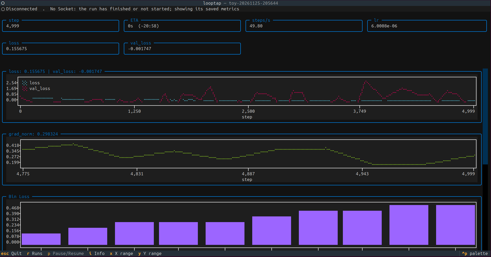
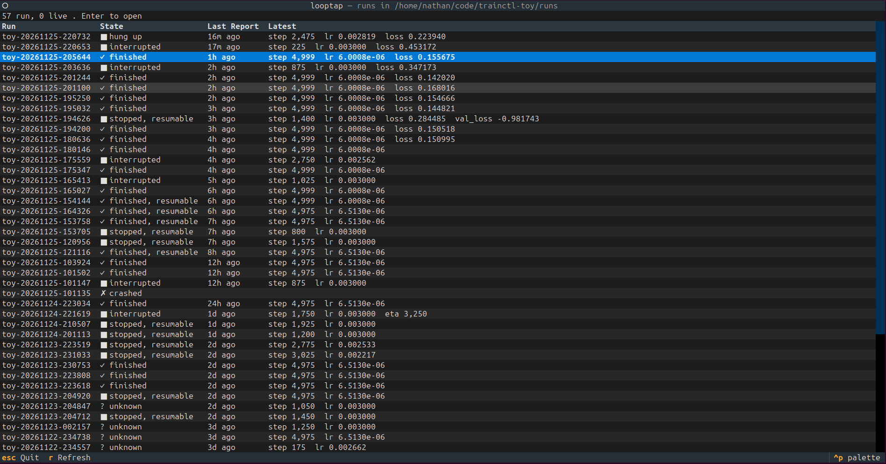

# looptap

Watch and steer a running training loop from your terminal.



## Why?

Training runs are long, and most of the time you only want to glance at them. When something does need attention (a loss that's stalled, a setting that's clearly wrong, a run that needs to give its GPU back for a while), the usual options are to wait it out, or to kill it and start again.

looptap gives a training script a small control channel. The script reports its metrics as it goes and declares what can be changed while it runs. A terminal UI attaches whenever you want to look in: to see live plots, adjust a parameter, pause, trigger something the script defines, or stop with a checkpoint and pick it up again later. Then you detach, and training carries on as if you'd never been there.

## How it fits together

- **The script stays in charge.** It decides what to report, what can be changed, and when it's safe to apply changes. It runs the same whether or not the TUI is attached.
- **The TUI is a visitor.** Attach to a live run, detach, reattach from another terminal. Closing it never affects training.
- **Everything is local files.** Each run gets a directory with its metrics, declarations, and checkpoints, so finished and stopped runs can be browsed too. There's no server, account, or database.

## Features

### Live views

The script declares how its metrics are shown, and the TUI lays them out:

- **Values, rates, and ETAs** in a row along the top, such as the current step, steps per second, and time until the run finishes.
- **Line plots** of one or more series against any metric, such as training and validation loss against step, with the latest values in each plot's title. Plots can show the whole run or a rolling window, and their axis ranges can be fixed in the script or adjusted in the TUI.
- **Bar charts and histograms** of vector metrics, such as loss by timestep bin or a batch of sampled timesteps. Histogram bins can have unequal widths.

### Control

- **Params** are values the TUI can change while the run goes, like a learning rate multiplier or the number of accumulation steps. The script declares each one's type and range, and changes are checked against them.
- **Actions** are things the script knows how to do on request, like saving a sample grid or running validation.
- **Pause and resume** happen at a point in the loop the script chooses.
- Every change is confirmed by the running script before the TUI shows it, and rejected changes come with a reason.

### Stop and resume

A script that tells looptap how to save and load its state can be stopped from the TUI: it saves a checkpoint, frees its GPU, and exits. Later it can be resumed from the TUI or the command line, carrying on from where it stopped, with the same settings and its earlier metrics still in the plots.

### Runs



- **A run picker** lists every run with its state (live, stopped and resumable, finished, crashed), when it last reported, and its headline values.
- **Saved runs** that aren't running can still be opened, showing everything they reported.
- **Run info** shows when and where a run started, and the fixed configuration (hyperparameters) the script recorded for it.

## A taste

```python
from looptap import Param, Plot, Rate, Value, run


def train(ctl):
    for step in range(total_steps):
        ctl.poll()  # apply changes from the TUI here, where it's safe
        loss = train_step(lr=base_lr * ctl.params.lr_scale)
        if step % 25 == 0:
            ctl.report({"step": step, "loss": loss})


run(
    train,
    metrics=["step", "loss"],
    views=[
        Value("step"),
        Rate("step", label="steps/s"),
        Plot(x="step", y="loss"),
    ],
    params=[Param("lr_scale", float, default=1.0, min=0)],
    config={"base_lr": base_lr, "batch_size": batch_size},
    pausable=True,
)
```

Run the script as usual, then run `looptap` in another terminal on the same machine to pick a run and attach. In the TUI, `c` shows the controls, `i` shows the run's info, and Escape goes back to the list of runs.

## Installation

looptap isn't on PyPI yet:

```
uv add "looptap[tui] @ git+https://github.com/Nathan-Van-Maastricht/looptap"
```

Machines that only run training can install plain `looptap`, without the TUI's dependencies. Requires Python 3.10 or later, on Linux or macOS.

## Status

looptap is in early development, and its API and protocol may still change.